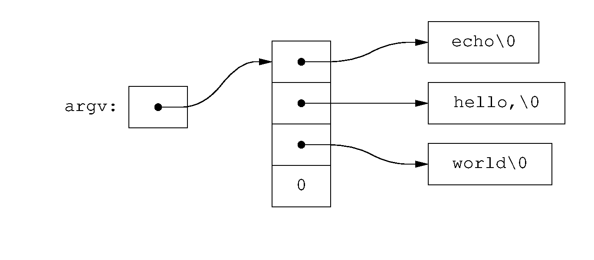

# Where are argc and argv?

There is something satisfying about knowing how things really do happen under the hood. Today let's take a look at where are stored the arguments to a program. You know the argc and argv from the main function in C?

```C
int main(int argc, char **argv) {
  return 0;
}
```

These arguments are passed to the new executable trough the early stack. At this time the stack has two items inside on x86_64 which we're gonna focus on, the size of them is 8 bytes or 64 bits. The first is argc which is just an integer telling us how many arguments are present, the second is argv a pointer to an array, sometimes called vector, of arguments. Each arguments consist of a pointer to a array of character sometimes known as a string which ends up with null byte. So the layout is:


